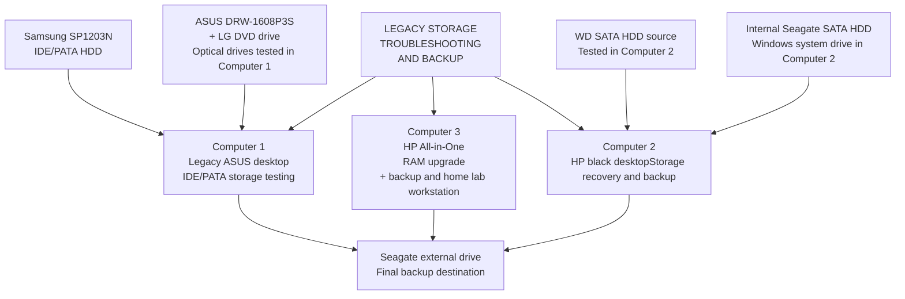
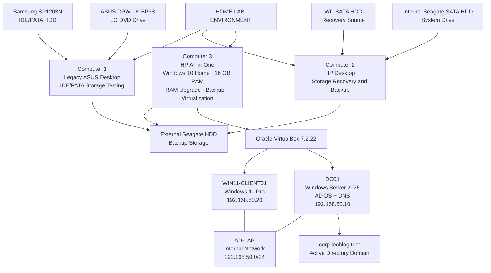

# 🖥 Lab Environment Overview

---

This document provides an overview of the home lab environment, including the computers, storage devices, backup infrastructure, and virtual Windows client–server environment used for practical IT projects.

---

## 1. Legacy Storage and Backup Environment

---

## 2. Complete Home Lab Environment

---
