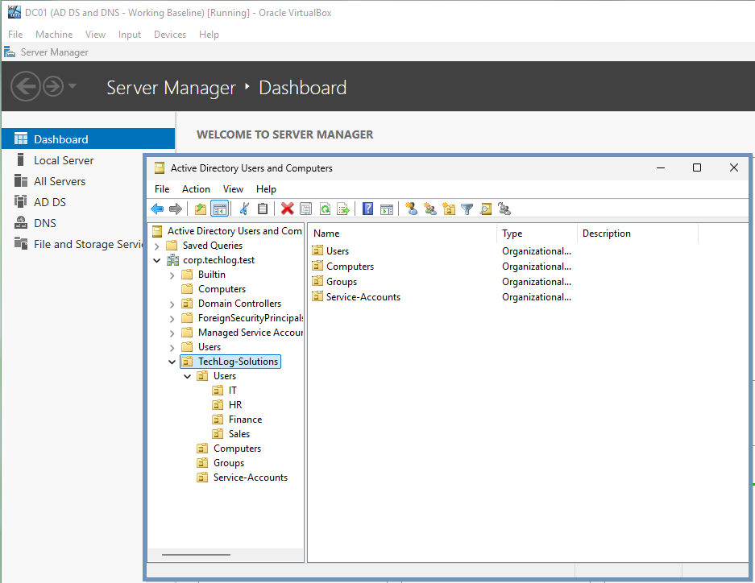
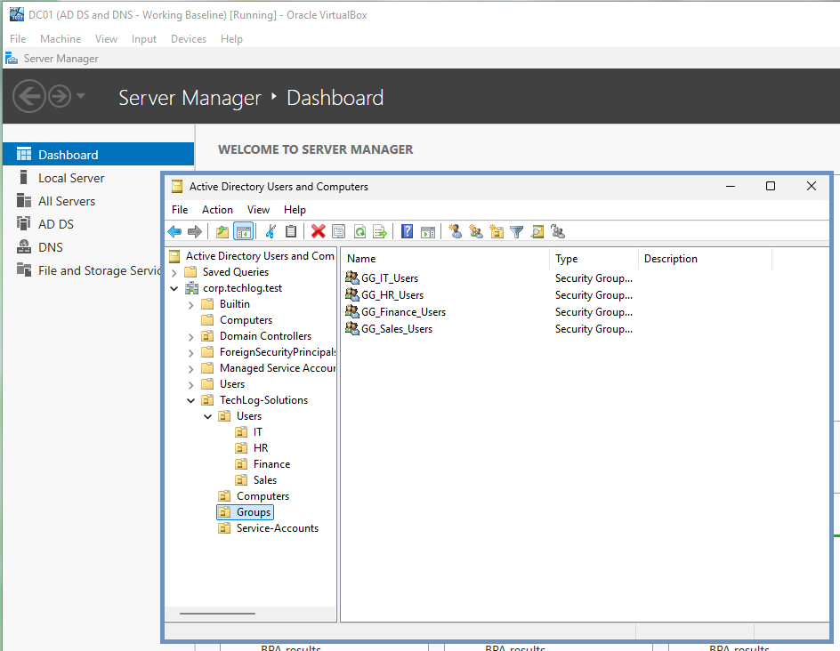
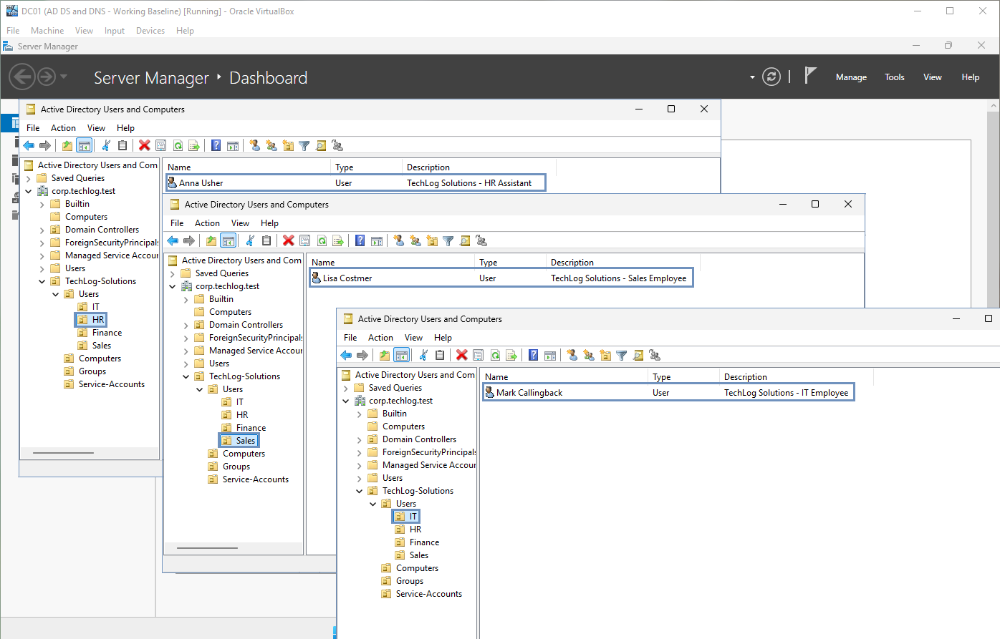
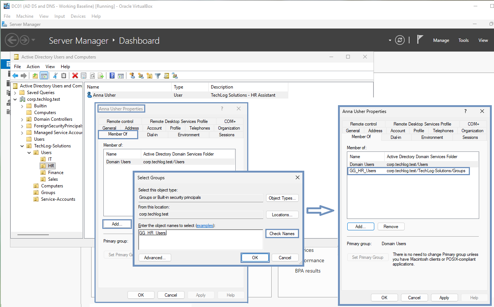
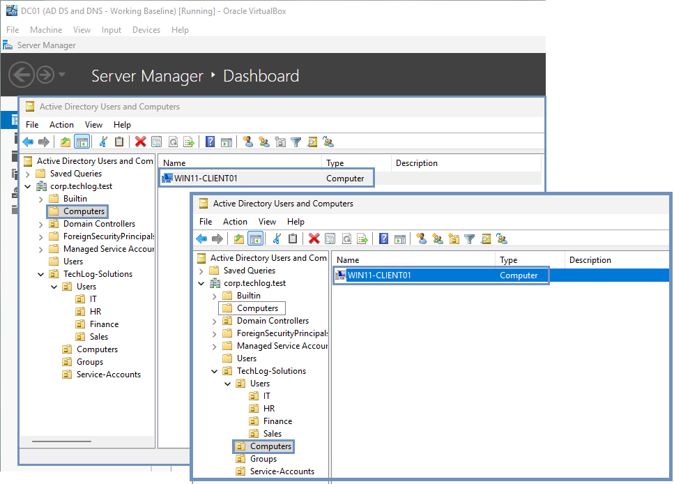
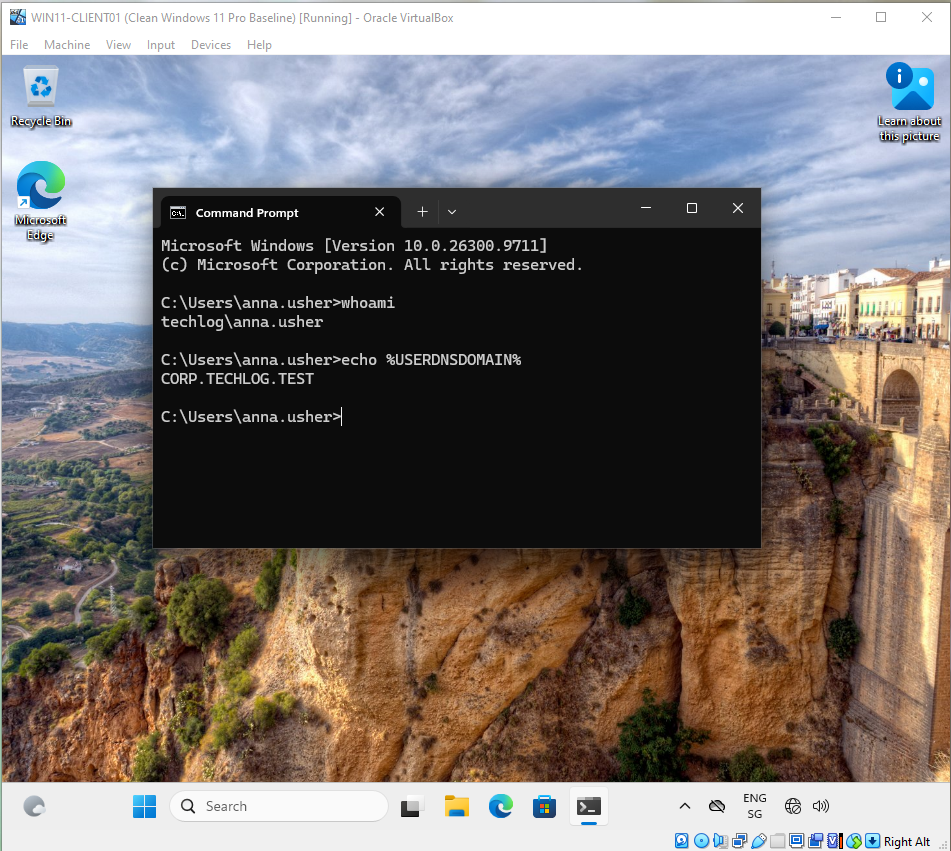

# Active Directory - OU, User and Group Management


---

## Objective

Implement and verify a structured Active Directory environment for the fictional company **TechLog Solutions**, including organizational units (OUs), employee accounts, departmental security groups, group memberships, and computer account management.

Validate standard domain-user authentication on a Windows 11 Pro workstation.

---

## Lab Environment

| Component | Configuration |
|---|---|
| Domain Controller | `DC01` - Windows Server 2025 Standard Evaluation |
| Client workstation | `WIN11-CLIENT01` - Windows 11 Pro |
| Domain | `corp.techlog.test` |
| NetBIOS name | `TECHLOG` |
| Internal network | `AD-LAB` - `192.168.50.0/24` |
| Administration tool | Active Directory Users and Computers (ADUC) |

---

## Implementation

### 1. Organizational Unit Configuration

Created a departmental OU structure under `TechLog-Solutions`, separating users, computer accounts, and security groups.

- Configured departmental OUs for **IT, HR, Finance, and Sales**.
- Created dedicated OUs for computers, security groups, and service accounts.
- Applied consistent naming conventions and retained protection against accidental deletion.
- Preserved the default Active Directory containers and the built-in `Domain Controllers` OU.



*Organizational unit structure in Active Directory.*

### 2. Security Group Configuration

Created four departmental security groups using **Global** scope and **Security** type.

| Security group | Department |
|---|---|
| `GG_IT_Users` | IT |
| `GG_HR_Users` | Human Resources |
| `GG_Finance_Users` | Finance |
| `GG_Sales_Users` | Sales |

The `GG_` prefix identifies Global Security groups. These groups establish a foundation for departmental access management and future role-based permissions.



*Global Security groups created for the four departments.*

### 3. User Account Provisioning

Created three fictional employee accounts in their corresponding departmental OUs.

| Employee | User logon name | Department | Job title |
|---|---|---|---|
| Anna Usher | `anna.usher` | HR | HR Assistant |
| Lisa Costmer | `lisa.costmer` | Sales | Sales Employee |
| Mark Callingback | `mark.callingback` | IT | IT Employee |

Configured employee identity attributes, including department, job title, and description.

Each user was provisioned as a standard domain account with an initial temporary password and a mandatory password change at first sign-in. No additional administrative privileges were assigned.



*Employee accounts organized by department.*

### 4. Security Group Membership

Assigned each employee accounts to the corresponding departmental Global Security group.

| User | Assigned group |
|---|---|
| Anna Usher | `GG_HR_Users` |
| Lisa Costmer | `GG_Sales_Users` |
| Mark Callingback | `GG_IT_Users` |

Verified group assignments through **ADUC → User Properties → Member Of**. The default `Domain Users` membership was preserved.



*Anna Usher's HR security-group membership verified.*

### 5. Computer Account Management

Moved the domain-joined Windows 11 workstation `WIN11-CLIENT01` from the default Active Directory `Computers` container into the managed **TechLog-Solutions → Computers** OU.

Verified the computer object's presence in its new location without modifying its domain membership.

The Domain Controller `DC01` remained in the built-in `Domain Controllers` OU.



*WIN11-CLIENT01 in the managed Computers OU.*

---

## Verification & Results

### Standard Domain-User Authentication

Tested domain authentication using Anna Usher's newly created employee account on `WIN11-CLIENT01`.

The initial sign-in required a password change. After completing the password change, the user successfully authenticated to the TechLog Solutions domain.

The following commands verified the identity and domain context:

```cmd
whoami
echo %USERDNSDOMAIN%
```

**Verified output:**

```text
techlog\anna.usher
CORP.TECHLOG.TEST
```



*Successful domain sign-in as TECHLOG\anna.usher.*

### Verification Summary

| Verification | Result |
|---|---|
| Company and departmental OUs | Created and verified |
| Four Global Security groups | Created and verified |
| Three employee accounts | Created and verified |
| Departmental group memberships | Assigned and verified |
| Windows 11 computer account organization | Completed and verified |
| Standard domain-user authentication | Passed |
| Mandatory password change at first sign-in | Completed |

**Result:** Successfully established a structured Active Directory environment for TechLog Solutions, including departmental identity management, security-group assignments, computer account organization, and verified standard-user domain authentication.

---

## Skills Demonstrated

- Active Directory Users and Computers (ADUC)
- Organizational Unit (OU) administration
- User account provisioning and attribute management
- Global Security group creation and membership management
- Active Directory computer account management
- Domain-user authentication
- Temporary password and first-logon password-change configuration
- Least-privilege user provisioning
- Configuration verification and evidence documentation
